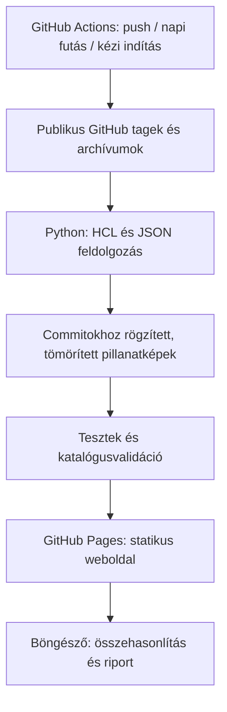

# ModuleLens

**Terraform- és OpenTofu-modulok frissítési különbségei, forrásokkal és feltételes teendőkkel.**

Válaszd ki a modult, az almodult, a jelenlegi és a célverziót. Az alkalmazás
megmutatja a deklarációk közötti eltéréseket, az érintettség feltételét és a
szükséges ellenőrzést vagy módosítást. Nem szükséges saját kódot vagy state-et
feltölteni, és a weboldal nem kér GitHub- vagy AI-tokent.

## Funkciók

- Terraform / OpenTofu motorválasztó, tényleges `.tofu` fájl-elsőbbséggel.
- Modul- és almodulválasztás, stabil verziók numerikus rendezése.
- Bemenetek: hozzáadás, törlés, dokumentált átnevezés, típus, alapérték,
  validáció, nullable, sensitive és ephemeral beállítás.
- Outputok, provider- és CLI-követelmények, belső modulhívások változásai.
- Erőforrás-deklarációk és `moved` / `removed` / `import` blokkok eltérései.
- Verziótartományra szűrt changelog és elérhető migrációs dokumentumok.
- Keresés, súlyosság- és kategóriaszűrés, megosztható URL.
- Markdown- és JSON-export, böngészős nyomtatás / PDF.
- Reszponzív magyar felület, világos és sötét megjelenés, billentyűzetes kezelés.
- Commitazonosítóhoz kötött bizonyíték minden megállapítás mellett.
- Automatikus adatfrissítés és GitHub Pages-telepítés GitHub Actionsből.

Az első katalógus: **AWS EKS, VPC, S3 Bucket; Google Cloud Network és GKE**.
Valós upstream adatokkal előre feltöltött katalógust tartalmaz, ezért az első
induláshoz nem kell megvárni egy adatgyűjtést.

## GitHub Pages: telepítés

1. Töltsd a projekt teljes tartalmát egy GitHub-repository `main` ágába.
   GitHub Free használatához publikus repository javasolt; a privát repós
   Pages elérhetősége a GitHub-csomagtól függ. A repository publikusra állítása
   a kódot és az indexelt adatokat is nyilvánossá teszi.
2. **Settings → Pages → Build and deployment → Source → GitHub Actions.**
3. **Actions → Refresh catalog and deploy Pages → Run workflow.** Első
   indításhoz a `refresh_catalog` kikapcsolható, mert a katalógus már a repóban van.
4. A sikeres deploy után a workflow `github-pages` környezetének URL-je nyitja az oldalt.

Az útvonalak relatívak: a `https://USER.github.io/REPOSITORY/` forma is működik,
nem kell gyökérdomain vagy egyedi domain. A frontend buildless ES-modulos
HTML/CSS/JavaScript, nincs külön Node- vagy Python-szerver éles üzemben.

### Mit futtat a workflow?



A workflow naponta **04:23 UTC** időpontban fut. A gyűjtés csak publikus
forrásokat olvas. A GitHub által biztosított `GITHUB_TOKEN` kizárólag az Actions
környezetében kerül felhasználásra, a `api.github.com` API-hívásokhoz; nem
kerül adatfájlba, frontendbe vagy a letöltött upstream forrásokhoz. Más titok
vagy fizetős AI API nem szükséges.

A `pages.yml` buildje hibás gyűjtésnél vagy sikertelen tesztnél nem publikál:
a korábbi működő weboldal marad elérhető. A frissítés nem commitolja vissza az
adatokat a repóba; a deploy-artifact és az Actions cache tartalmazza az aktuális
katalógust. A repóba csomagolt adatok frissítéséhez futtasd a gyűjtőt helyben
és commitold a `web/data` változásait. A cache a snapshotok gyorsítótára;
eltűnése esetén az adatok újra előállíthatók.

## Helyi futtatás

Szükséges: **Python 3.12+**, **Node.js 22+**, modern böngésző a natív
`DecompressionStream` API támogatásával.

```bash
python -m venv .venv
source .venv/bin/activate
python -m pip install -r requirements.txt
npm ci
npm run serve
```

Nyisd meg: **http://localhost:8080/**. Windows PowerShell esetén az aktiválás:
`.venv\Scripts\Activate.ps1`. A `file://` megnyitás ES-modulok és fetch miatt
nem támogatott. A kiszolgáló csak helyi fejlesztésre szükséges.

```bash
# Parser-, archívum- és összehasonlítási tesztek
python -m unittest discover -s tests -p 'test_*.py' -v
npm test

# Katalógus referenciáinak ellenőrzése és statikus csomagolás
python scripts/build.py

# Adatok frissítése upstream forrásokból
python -m collector.collect

# Egyetlen modul frissítése
python -m collector.collect --only aws-eks

# Minden kiválasztott verzió ismételt feldolgozása
python -m collector.collect --refresh
```

API-token nélkül a GitHub publikus API-korlátja érvényes. Nagyobb gyűjtéshez a
`GITHUB_TOKEN` környezeti változóban megadott, publikus olvasásra alkalmas token
használható. Ne írd be a tokent a forráskódba vagy a frontendbe.

## Új modul vagy hiányzó verzió hozzáadása

Példa a `modules.json` egyik elemére:

```json
{
  "id": "aws-eks",
  "name": "EKS",
  "namespace": "terraform-aws-modules",
  "registry_name": "eks",
  "provider": "aws",
  "repository": "terraform-aws-modules/terraform-aws-eks",
  "description": "Amazon EKS klaszterek és node groupok",
  "anchors": ["v20.37.1", "v21.0.0"],
  "recent": 6
}
```

- `repository`: publikus, közvetlenül elérhető GitHub-repository.
- `id`: egyedi fájlrendszerbiztos azonosító; ne változtasd meg meglévő linkeknél.
- `anchors`: kötelezően indexelendő, a vizsgált tagek között megtalálható verziók.
- `recent`: a legfrissebb stabil kiadások száma, alapértelmezetten 6.
- A legutóbbi három megtalált főverzió első és utolsó stabil kiadása is bekerül,
  amennyiben elérhető a beolvasott taglistában.

Ezután futtasd a gyűjtőt, a teszteket és a buildet, majd commitold a módosítást.
A weboldal látogatói csak az indexelt katalógusból választanak. Az első verzió
nem biztosít anonim, tetszőleges upstream letöltést vagy privát repós hozzáférést.

## Az eredmények értelmezése

| Besorolás | Jelentés |
|---|---|
| Kötelező teendő | Az adott érintettségi feltétel teljesülésekor módosítás szükséges. |
| Feltételes módosítás | Például egy törölt bemenet vagy output használata esetén kell módosítás. |
| Ellenőrizendő | Működés, függőség, belső erőforrás vagy state-kezelés változott. |
| Új lehetőség | Opcionális bemenet vagy új output; használata külön döntés. |
| Hiányos elemzés | Parserhiba, ismeretlen blokk vagy nem kiértékelt override szemantika. |

A „nem találtunk kötelező módosítást” állítás kizárólag az elemzett
deklarációkra vonatkozik. Nem teljes kompatibilitási tanúsítvány.

### Tudatos korlátok

- A HCL-t parser dolgozza fel, de **nem értékelünk ki kifejezéseket**, típusok
  kompatibilitását, `count` / `for_each` feltételeket vagy provider API-kat.
- A Terraform/OpenTofu motorválasztás a fájlkiválasztást különbözteti meg.
  Nem helyettesíti az adott CLI-verzióval végzett `validate` és `plan` ellenőrzést.
- Egy főmodul lokális almoduljainak változásai a megfelelő almodul külön
  kiválasztásával vizsgálhatók; a tranzitív függőséggráf nincs kiértékelve.
- Az erőforrás-deklaráció eltérése **nem bizonyít erőforráscserét**. Ehhez a
  saját konfiguráció és a state alapján készülő plan szükséges.
- A típusváltozásokat jelezzük, de nem állítjuk, hogy minden típuseltérés törés.
- Átnevezést csak explicit dokumentált `old -> new` / `old → new`
  megfeleltetésből állítunk. Egyébként törlés és hozzáadás marad.
- A dokumentumok a kiválasztott pillanatképekből származnak. A changelog
  szemverziós fejlécei alapján a teljes kiválasztott verziótartományra szűrünk.
  A köztes kiadások teljes szemantikai elemzése és a dokumentáció teljessége
  nem garantált. Nem verziózható migrációs útmutatók további áttekintést igényelnek.
- Csak stabil `vMAJOR.MINOR.PATCH` / `MAJOR.MINOR.PATCH` tagek támogatottak.
  Legfeljebb 400 tag kerül vizsgálatra repositorynként; prerelease és monorepós
  komponensspecifikus tagek nincsenek támogatva.
- A token nem jut a frontendbe. A snapshotok és a bennük lévő dokumentáció
  publikus a Pages-oldalon. Privát vagy bizalmas modul nem kerülhet a katalógusba.
- Nem futtatunk letöltött kódot, Terraformot, OpenTofut, plan vagy apply parancsot.

## Projektfelépítés

```text
collector/              HCL/JSON feldolgozás és publikus upstream adatgyűjtés
modules.json            Indexelendő modulok és rögzített verziók
web/index.html          Magyar, hozzáférhető webes felület
web/style.css           Reszponzív elrendezés és nyomtatási nézet
web/tokens.css          Világos/sötét színek
web/app.js              Felhasználói folyamat, szűrés, export, megosztás
web/lib/compare.js      Önállóan tesztelhető összehasonlítási motor
web/data/               Előre gyűjtött katalógus és gzip JSON-pillanatképek
scripts/build.py        Integritásellenőrzés és dist/ előállítás
tests/                  Parser-, biztonsági és viselkedési tesztek
.github/workflows/      CI, napi adatfrissítés és Pages-deploy
```

## Licenc és upstream források

Az alkalmazáskód MIT-licencű. Az indexelt deklarációk és dokumentumok az
upstream projektek licencfeltételei alatt maradnak; minden pillanatkép tartalmazza
a hozzá tartozó eredeti licencszövegeket és forráshivatkozásokat.
Lásd: [THIRD_PARTY_NOTICES.md](THIRD_PARTY_NOTICES.md).

- [GitHub Pages egyedi workflow](https://docs.github.com/en/pages/getting-started-with-github-pages/using-custom-workflows-with-github-pages)
- [OpenTofu fájlkiválasztás](https://opentofu.org/docs/language/files/)
- [Hivatalos Terraform modulfrissítési útmutató](https://developer.hashicorp.com/validated-patterns/terraform/upgrade-and-refactor-terraform-modules)
- [python-hcl2](https://github.com/amplify-education/python-hcl2)
